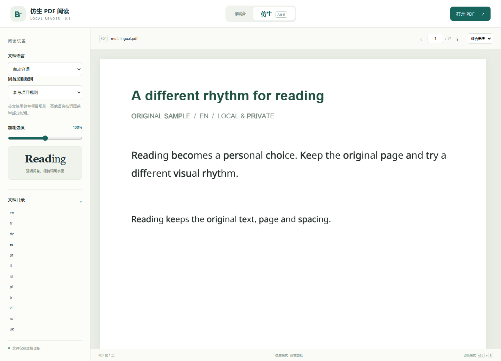

# Bionic PDF Reader

[中文](README.md) · [Downloads](https://github.com/Yanxxzz/bionic-pdf-reader/releases) · [Compatibility](docs/compatibility.md)

Local, multilingual word-prefix emphasis for PDFs, preserving original text, glyph positions, page layout and figures. Toggle between original and bionic rendering in a browser, or make a reading copy for a desktop PDF reader.



## Use it

- **Chrome and Edge:** unzip the extension release, enable developer mode, then load the directory containing `manifest.json`. Open a local PDF and toggle with `Alt+B`.
- **Windows:** run the standalone `BionicPDF.exe`. It requires no Python installation. Create a switchable PDF or an always-emphasized PDF, or launch the local browser reader.
- **WPS, Acrobat, Foxit, PDF-XChange:** use the generated switchable copy and toggle its Bionic Reading layer in the reader's Layers panel. Native application verification and standards-based compatibility are documented separately.
- **Other readers:** use static export, which does not need a layer toggle.
- **Firefox:** use the local web reader or the temporary development extension. A signed Mozilla add-on is not included.

The tool offers a visual reading preference, without claiming proven gains in reading speed, comprehension, or clinical outcomes.

## Languages

PDF fixtures cover 16 languages, including accented Latin text, Cyrillic, Greek and experimental Chinese/Japanese/Korean segmentation. Arabic, Hebrew and Hindi have grapheme/word-boundary unit coverage; complex shaping and real-world typography remain experimental. Browser segmentation uses `Intl.Segmenter`; the Python converter uses Unicode boundaries, jieba and TinySegmenter. Their boundaries can differ.

The PDF converter supports embedded single-byte Type1/CFF and TrueType fonts, plus Identity-H CID TrueType fonts with valid Unicode mappings. Scans, vertical writing, unsupported font programs, and text inside nested Form XObjects remain unchanged. No OCR is bundled.

## Development

Python 3.11+, Node.js 22+. tkinter is required for the Python GUI, not for the CLI.

```sh
python -m pip install -e ".[dev]"
npm ci
npx playwright install chromium firefox
python scripts/make_examples.py
python -m pytest
npm test
npm run test:browser
npm run test:extension
```

```sh
bionic-pdf source.pdf reading.pdf --mode switchable --language auto
bionic-pdf source.pdf static.pdf --mode static --language fr
python scripts/build_packages.py
python -m build
# Windows standalone executable:
python -m pip install -e ".[windows]"
python scripts/build_windows.py
```

To run the web reader, serve `extension/` on loopback and open `reader.html`. The installed wheel contains the converter; browser assets are included in the source checkout and standalone Windows bundle.

## Privacy and licenses

Processing stays local. The software does not upload selected PDFs or reading history. A third-party reader's own cloud-sync settings are separate. Source PDFs are never overwritten. Vector overlays do not add duplicate copyable text.

Original code is MIT licensed. PDF.js is Apache-2.0; third-party resources retain their own licenses. See [THIRD_PARTY_NOTICES.md](THIRD_PARTY_NOTICES.md). Demo documents contain original text and renamed subsets of OFL Noto fonts. No textbook or personal document is distributed.

Independent project; not affiliated with the Bionic Reading trademark owner, Mozilla, WPS, Adobe or Foxit.
