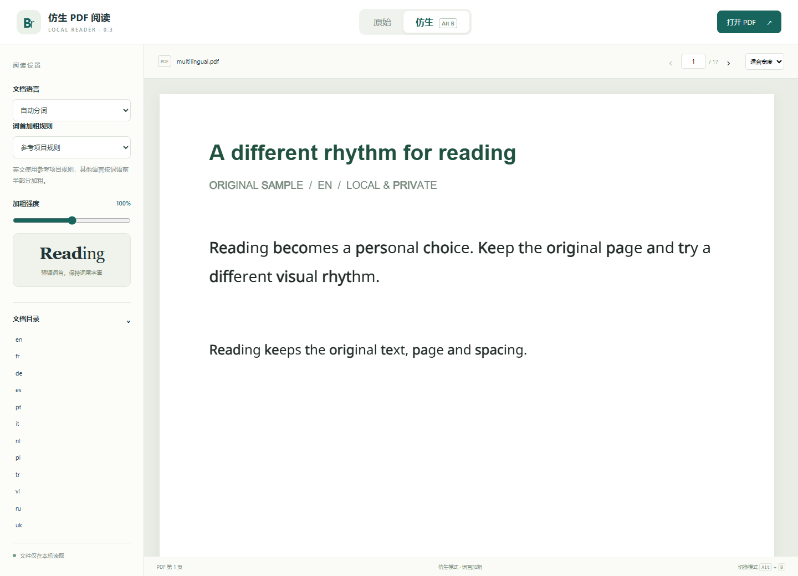

# 仿生阅读 PDF 阅读器 · Bionic PDF Reader

[下载最新版本](https://github.com/Yanxxzz/bionic-pdf-reader/releases/latest) · [安装与使用](docs/usage.md) · [阅读器兼容性](docs/compatibility.md) · [English](README.en.md)

仿生阅读（Bionic Reading）把 reading 显示成 **read**ing。读英文教材、论文或长篇报告时，你可以在同一页开关词首加粗，图表、公式和页码都留在原位，正文仍可选择和复制。PDF 在本机处理。

如果你想加快英语阅读速度、寻找更有效的阅读方式，可以先用一段熟悉的文字试读。浏览器里按 `Alt+B`（Mac 上是 `Option+B`）来回对照，再调整加粗强度，看看哪种字重让你更容易跟上下一行。

## 用你平时的阅读器

| 你在哪里读 PDF | 选择什么 | 怎样使用 |
| --- | --- | --- |
| Chrome、Edge | 浏览器扩展 | 点扩展图标，打开本地 PDF，在阅读页切换「原始」或「仿生」。 |
| Safari、Firefox | 本地网页阅读器 | 点「打开 PDF」，从系统文件窗口选文件。Firefox 也提供临时开发扩展。 |
| WPS PDF、Adobe Acrobat Reader、福昕 Foxit PDF Reader、PDF-XChange Editor | 可切换版 PDF | 用制作工具生成一次副本，以后在阅读器的「图层 / Layers」面板开关 `仿生阅读 · Bionic Reading`。 |
| macOS 预览（Preview）、SumatraPDF、Apple Books、手机或平板阅读器 | 普通仿生 PDF | 生成后直接打开，词首始终加粗。要看原始排版，打开原文件。 |

Acrobat Reader 已逐页核对 13 种语言，开关前后从同一选区复制的文字一致。Safari 26.6 和 27.2 各验证了 26 个页面案例，关闭后正文截图逐像素恢复。WPS、Foxit、PDF-XChange 已实际检查桌面图层开关。Preview 已验证打开文件，手机和其他应用采用通用 PDF 适配。[各阅读器的实测范围](docs/verification.md)



## 安装并打开第一份 PDF

- **Chrome / Edge** 下载文件名含 `chrome-edge` 的 ZIP 并解压。在 `chrome://extensions` 或 `edge://extensions` 打开开发者模式，点「加载已解压的扩展程序」，选择含 `manifest.json` 的目录。点扩展图标即可试读。
- **Windows 制作工具** 下载并完整解压 `windows-x64` ZIP，双击 `BionicPDF.exe`。选原始 PDF 和新的保存位置，再按上表选「可切换版」或「普通仿生版」。也可以点「在浏览器中阅读」直接打开本地阅读页。此包自带运行环境。
- **Mac 上用 Safari，或用其他浏览器** 下载并解压 `web-reader` ZIP。在含 `reader.html` 的目录运行下面的命令，再用浏览器打开 `http://127.0.0.1:8765/reader.html`。命令需要 Python 3。

```sh
python3 -m http.server 8765 --bind 127.0.0.1
```

每个 ZIP 都有可离线打开的 `使用指南.html`。Firefox 临时扩展的加载方法和各桌面阅读器的图层入口见[使用说明](docs/usage.md)。

**开发版**可以在 Chrome 或 Edge 已打开的 PDF 标签页点扩展图标开始阅读。本地文件需在扩展详情中启用「允许访问文件网址」。论文中的网页和 DOI 会在新标签页打开，重开同一份文档也能接续页码、缩放和页内位置。这些改动可从源码的 `extension` 目录加载。[操作步骤](docs/usage.md)

## 哪些文档适合

支持 **13 种文档语言**，包括英语、法语、德语、西班牙语、葡萄牙语、意大利语、荷兰语、波兰语、土耳其语、越南语、俄语、乌克兰语和希腊语。浏览器可选英语参考规则或词语前半部分规则。制作工具选英语时对纯英文字母词使用参考规则，自动模式和其他 12 种语言按完整字素加粗前半词。手动选择还会设置副本的文档语言标记。[语言与排版规则](docs/languages.md)

优先选择可以选中正文的 PDF。阅读页支持全文查找上一处、下一处，点击书内引用可跳到目标段落并返回原处。制作工具可导出双页讲义，并列出整页未加粗的副本页码。扫描图片需要先做 OCR，竖排和部分特殊字体会保留原样。[字体及 PDF 支持范围](docs/compatibility.md)

## 命令行与开发

Python 3.11 或更新版本可以安装发布页上的 `.whl`，也可以在源码目录运行下面的命令。安装后运行 `bionic-pdf-gui` 可打开制作工具和内置的本地阅读页。

```sh
python -m pip install .
bionic-pdf source.pdf switchable.pdf --mode switchable --language en
bionic-pdf source.pdf mobile.pdf --mode static --language en
```

浏览器使用 PDF.js 在原字形上绘制加粗笔画。桌面工具使用 pypdf 和 fontTools 将笔画写入副本，复制时读取的仍是原来的文字。环境设置、模块职责、测试命令和打包步骤见[开发说明](docs/development.md)。

## 许可与致谢

项目代码采用 MIT 许可。英语词首参考规则来自 yitong2333 的 Bionic-Reading，PDF.js、字体和其他依赖保留各自的许可。[项目许可](LICENSE) · [参考项目](https://github.com/yitong2333/Bionic-Reading) · [第三方声明](THIRD_PARTY_NOTICES.md)
